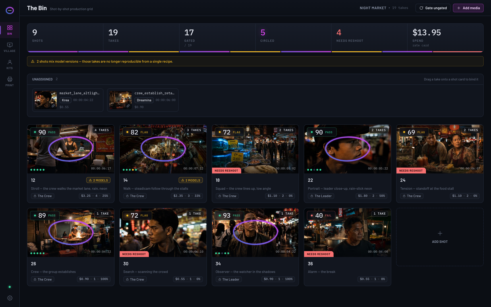
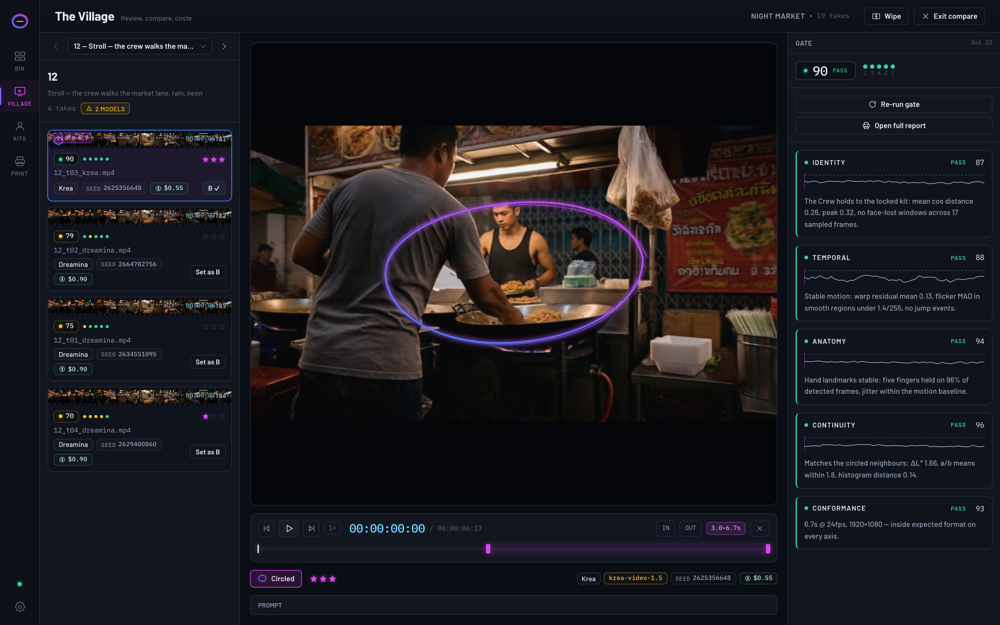
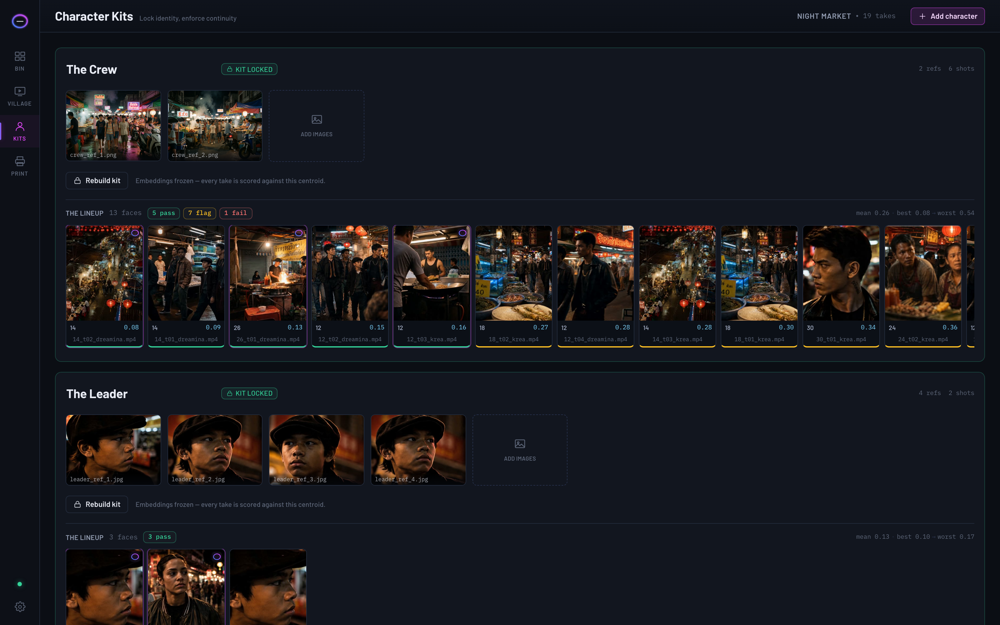
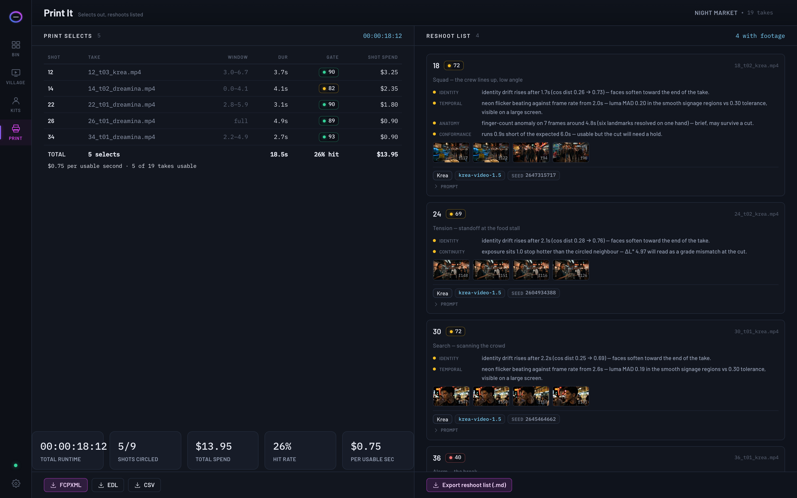

<div align="center">


**The dailies room for AI filmmaking.**

Every take you generate — organized by shot, gated by local AI quality checks,
compared side by side, circled, and printed to your editor. With a reshoot list
for everything that failed, carrying the exact prompt, seed, and *why*.

100% local · no accounts · no API keys · nothing ever uploaded

<p align="center">
  <a href="https://www.apache.org/licenses/LICENSE-2.0"></a>
  <a href="../../releases/latest"></a>
  
  <a href="https://ko-fi.com/samwasserman"></a>
</p>

</div>

---

AI filmmaking has a selection problem. Everyone can generate 40 takes of a shot;
nobody can manage them. Prompts and seeds get lost the moment the file leaves the
generator, characters drift between shots, artifacts hide until the edit, and the
"review process" is squinting at a folder called `output_final_v3`.

Circle Take is the missing room between your generator and your editor — named for
the take the director circles on the camera report. Only circled takes get printed.

## What it does

- **The Bin** — a shot-by-shot production grid. Drop in takes from *any* generator
  (Veo, Kling, Seedance, Runway, Dreamina, Krea, ComfyUI…); filenames bind them to
  shots, sidecar files fill in prompt/seed/model, and every card shows take count,
  best gate score, spend, and what still needs a reshoot.
- **The Gate** — five local QC checks on every take, each with a human-readable
  reason, per-frame sparklines, and worst-frame evidence:
  - **Identity** — face-embedding drift against a locked character kit
  - **Temporal** — flicker, generative churn, and morph/jump events via
    motion-compensated optical flow
  - **Anatomy** — hand landmark stability, bone-length consistency, joint limits
  - **Continuity** — exposure/palette drift against the neighboring shots in cut order
  - **Conformance** — duration, fps, aspect, frozen/black frames, sharpness
- **Character Kits** — lock a character from reference stills; every take in every
  shot is scored against the kit. The lineup wall shows drift at a glance.
- **The Village** — a review room built for rejecting at scale: scrub-locked A/B
  compare, wipe, J-K-L transport, one-key circling, star ratings — and a word-level
  **prompt diff** between any two takes, so "what changed between take 7 and 8"
  finally has an answer.
- **Select windows** — keep the 2.8 usable seconds of a 20-second generation. The
  gate suggests the cleanest continuous span; exports honor your window.
- **Cost ledger** — set a per-generation rate per model and see spend per shot,
  hit rate, and cost per usable second.
- **Print It** — circled takes export as **FCPXML** (Resolve-ready) or **EDL/CSV**;
  failing shots export as a **reshoot list** with the exact recipe to re-run.

## Download

**macOS (Apple Silicon) — one-line install** (recommended; avoids the Gatekeeper
"app is damaged" false alarm that macOS shows for unsigned browser downloads):

```bash
curl -fsSL https://raw.githubusercontent.com/wassermanproductions/circle-take/main/install.sh | bash
```

| Platform | Download |
|---|---|
| macOS (Apple Silicon) | [CircleTake-mac-arm64.dmg](../../releases/latest/download/CircleTake-mac-arm64.dmg) · [zip](../../releases/latest/download/CircleTake-mac-arm64.zip) |

> **"Circle Take is damaged and can't be opened"?** The app isn't damaged — it's
> unsigned, and macOS quarantines browser downloads. Either use the one-liner
> above, or run `xattr -cr "/Applications/Circle Take.app"` once and reopen.

Requires [ffmpeg](https://ffmpeg.org) (`brew install ffmpeg`) and Python 3.10+.
On first launch the app builds its own Python environment and downloads its two
small vision models (~45 MB, checksum-pinned) — after that it runs fully offline.

<details>
<summary><b>Run from source</b></summary>

```bash
git clone https://github.com/wassermanproductions/circle-take.git
cd circle-take
npm install
python3 -m venv .venv && .venv/bin/pip install -r python/requirements.txt
npm run dev
```

</details>

## Drive it with an agent (MCP)

Circle Take ships an MCP server: any MCP agent (Claude Code, Hermes, Codex…) can
create projects, ingest takes, run gates, read reports, circle takes, and export —
the whole loop, headless. With the app running:

```bash
claude mcp add circle-take -- node <repo>/mcp/circle-take-mcp.mjs
```

See [mcp/README.md](mcp/README.md).

## The tour

| | |
|---|---|
|  |  |
| **The Bin** — the production at a glance | **The Village** — compare, gate, circle |
|  |  |
| **Kits** — continuity you can enforce | **Print It** — selects out, reshoots listed |

## Part of Wasserman's Filmmaker Suite

[ScriptBreak](https://github.com/wassermanproductions/scriptbreak) ·
[Cork Board](https://github.com/wassermanproductions/cork-board) ·
[Master Canvas](https://github.com/wassermanproductions/master-canvas) ·
[Blockout](https://github.com/wassermanproductions/blockout) ·
[Motion Previs Studio](https://github.com/wassermanproductions/motion-previs-studio) ·
[Storyboard Reference Studio](https://github.com/wassermanproductions/storyboard-reference-studio) ·
[Stem Studio](https://github.com/wassermanproductions/stem-studio) ·
[Unofficial DaVinci MCP](https://github.com/wassermanproductions/unofficial-davinci-mcp)

## Support

Circle Take is free and open source. If it saves your production time,
[buy Sam a coffee on Ko-fi](https://ko-fi.com/samwasserman) — it keeps the suite growing.

## License

Apache-2.0. Created by **Sam Wasserman**
([wassermanproductions.com](https://wassermanproductions.com) ·
[wasserman.ai](https://wasserman.ai)) — see [NOTICE](NOTICE).
Model weights are downloaded at runtime from their upstream sources
(OpenCV Zoo, MediaPipe) under their own permissive licenses.
